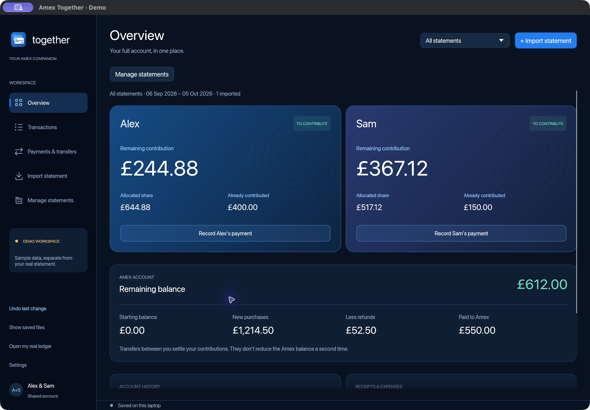
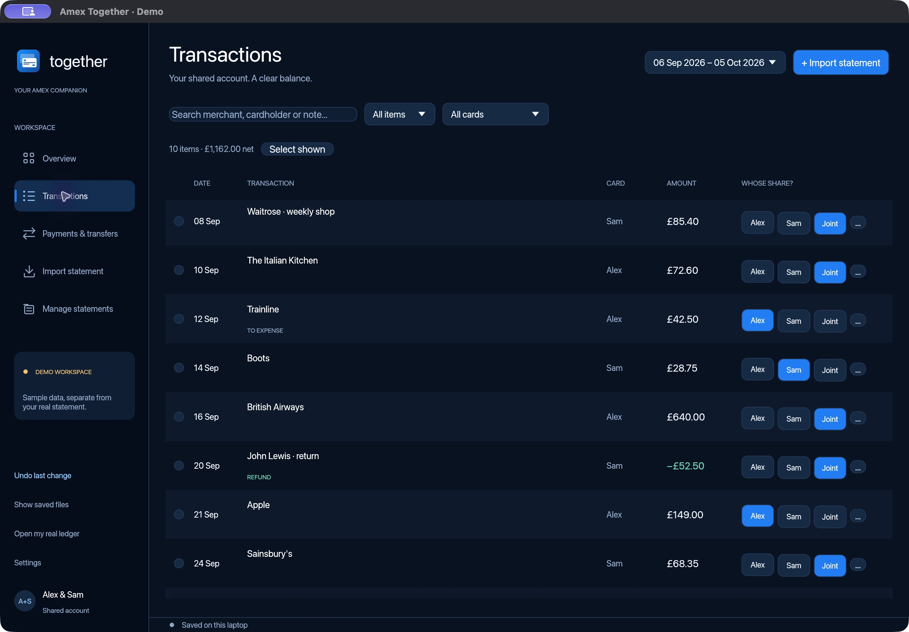
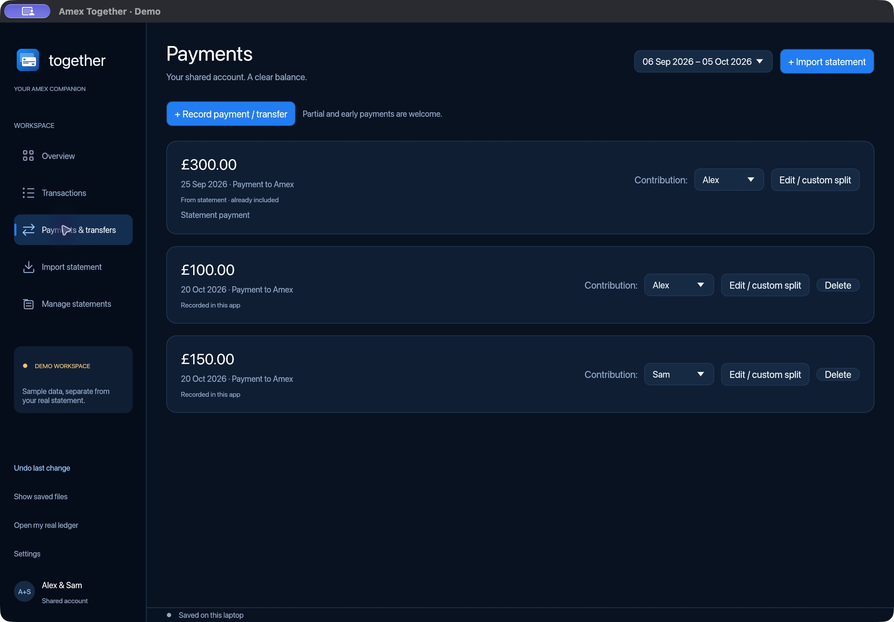

# Amex Together

A desktop app for reconciling joint and personal spending on one Amex account. Import a statement, assign each purchase, and see what each person still needs to pay.

## Why this exists

I built Amex Together because I was finding it hard to work out what we each owed on our Amex account. Joint spending, personal purchases, refunds and payments were all mixed together.

I was going through paper statements with highlighters and a calculator, then keeping separate notes of who had paid what. I wanted a simple way to assign transactions quickly and have the calculations update as I went.

Now I can see what we each still owe and keep a record of the transactions and payments, even after I've got rid of the paper.

## See what is owed

The overview shows each person's allocated spending, contributions and remaining balance. It also shows the amount still due to Amex.



## Assign spending and refunds

Use the two name buttons for personal spending, or **Joint** for a 50/50 split. Click an active button again to leave the item unassigned. Use transaction details for an exact custom split, a note or a receipt.



The allocation filter shows purchases assigned only to that person. Their overview balance also includes their share of joint purchases. The Card filter shows which card was used; it does not decide who owes the money.

## Record payments

Attribute repayments found on a statement, or record an early or partial payment yourself. Separate payments can have the same date and amount. Transfers between the two people settle their contributions without reducing the Amex balance twice.



All names and amounts in these screenshots are fictional. The app includes a separate demo workspace and a [sample CSV](examples/demo-statement.csv). The [complete demo ledger](examples/demo-ledger.json) also includes the two partial payments shown above.

## Run the app

The desktop build currently targets macOS. Install Rust, then run:

```sh
cargo run --release --bin amex-together
```

To build a macOS app you can open from Finder:

```sh
sh scripts/package-macos.sh
open 'dist/Amex Together.app'
```

To try the built-in example without using your own statement:

```sh
cargo run --release --bin amex-together -- --demo
```

To open the exact example shown in the screenshots:

```sh
cargo run --release --bin amex-together -- --demo --restore examples/demo-ledger.json
```

The demo workspace is separate from your real ledger. Select **Open my real ledger** to switch back.

## Set up your account

1. Open **Settings** and enter the two display names.
2. Optionally enter the card member names printed on your statements. The app uses these to shorten the Card column. It does not assign spending automatically.
3. Choose **Import statement**, or drag a downloaded PDF into the app.
4. Check the import preview. The app blocks a PDF import if the extracted totals do not reconcile.
5. Assign purchases and refunds under **Transactions**. Attribute repayments under **Payments & transfers**.
6. Check **Overview** for the remaining contributions. It stays provisional while items remain unassigned.

Changing a display name does not change that person's allocations or payments. Names are saved in the local ledger, not in the source code.

## Import statements

The PDF reader supports a downloaded UK Amex statement layout and GBP amounts. Scans, password-protected PDFs and other layouts may need changes to the reader.

CSV import accepts `Date`, `Description`, `Amount` and optional `Card Member` and `Process Date` columns. Purchases are positive. Refunds and repayments are negative. Check the date range, opening balance and signed amounts before importing a CSV.

Re-importing the same file opens the saved statement and keeps your allocations. Overlapping statement periods are blocked to avoid counting spending twice.

## Understand the balances

**Remaining contribution** is a person's allocated spending, including refunds, less their attributed contributions. A negative balance means they have contributed more than their current share.

**Amex remaining balance** is the opening balance plus purchases, less refunds and payments to Amex. Unassigned repayments still reduce this balance, but they do not reduce either person's contribution until you attribute them.

**All statements** shows the combined account history. It includes the earliest opening balance and each later transaction once. Later brought-forward balances are excluded because they repeat spending already in the history.

A filtered statement shows that month's full opening balance and its own activity. If it is your earliest imported statement, assign any non-zero opening balance too. Removing earlier statements does not erase the opening balance printed on a statement you keep.

An early payment recorded against one statement can later appear on another. The combined overview matches these one-to-one by exact date and amount. Separate payments recorded against the same statement remain separate. Conflicting attributions are shown for review.

All calculations use integer pence. For an odd penny in a joint split, the first person receives the extra penny. Refunds reverse the same split.

## Keep receipts and records

Receipts are optional. Attach a photo or PDF to a transaction and mark **To expense later** if you need it. The app copies attachments into its local data folder.

Use **Export transactions as CSV** to save your allocations. Exports include the statement period and original transaction rows. Do not add brought-forward rows across statement periods when totalling a raw export.

Use **Manage statements** to remove a period from reconciliation. **Restore** brings it back with its saved allocations, payments and attachments. A recovery copy is saved before each removal or restoration.

**Undo last change** reverses the latest edit in the current session. With transactions selected, use **1**, **2** or **J** to assign them to the first person, second person or Joint.

## Store and back up your data

The app runs locally. It has no bank connection, account signup or analytics.

On macOS, data is stored in `~/Library/Application Support/Amex Together/`. The real ledger is `ledger.sqlite3`; the demo ledger is `demo.sqlite3`. Original statements, receipts and recovery copies stay alongside them.

Choose **Back up all data** to save a complete backup with attachments. Keep the backup folder together. To restore it:

```sh
'dist/Amex Together.app/Contents/MacOS/amex-together' --restore '/path/to/backup/ledger.json'
```

Restoration creates a new data folder and keeps your existing ledger. Use `--data-dir /path/to/folder` to choose another local workspace.

Version 0.2 stores allocations against stable person IDs. Older installations can use a local migration profile to keep their names and allocations. The app saves a recovery copy before upgrading an older ledger. See [development and migration notes](docs/DEVELOPMENT.md).

Statements, receipts, databases, backups and local migration profiles do not belong in the public repository. The screenshots and sample CSV use demo data only.

## Develop and contribute

```sh
cargo fmt --all --check
cargo clippy --all-targets -- -D warnings
cargo test --all-targets
```

See [development notes](docs/DEVELOPMENT.md) for the project structure and local migration format. Report issues with a synthetic example that reproduces the problem. Remove names, card numbers, account details and real transaction records before sharing a file or screenshot.

## Licence

The code and original card icon are available under the [MIT licence](LICENSE). Amex Together is an independent project and is not affiliated with American Express.
